<a href="https://sujal1607.github.io/sujal1607/">
  
</a>

  
  
  




<a href="https://sujal1607.github.io/sujal1607/#projects"></a>
<a href="https://sujal1607.github.io/sujal1607/#projects"></a>
<a href="https://sujal1607.github.io/sujal1607/#projects"></a>
<a href="https://sujal1607.github.io/sujal1607/#projects"></a>



  


  
  
  

